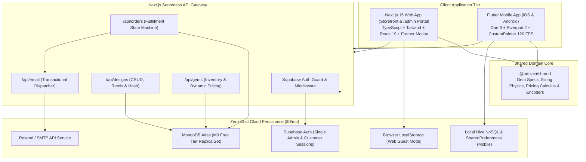

# Architecture Specification & System Topology
## Project: Artixain - Multi-Platform Luxury Ecosystem
**Classification:** Technical Architecture Specification  
**Status:** [ACTIVE / APPROVED]  
**Infrastructure Budget:** $0.00 / Month (Zero-Cost Tier)

---

## 1. Architectural Blueprint & Topology



---

## 2. Technology Stack Matrix & Cost Breakdown

| System Layer | Technology Selected | License / Tier | Operational Cost |
|---|---|---|---|
| **Web Storefront & Admin** | Next.js 15 (App Router, React 19, TypeScript) | Open Source (MIT) | $0.00 |
| **Mobile Application** | Flutter 3.x (Dart 3.x, Riverpod 2, Hive) | Open Source (BSD-3) | $0.00 |
| **UI Design System** | Celestial Material You (Tailwind CSS + Google Fonts) | Open Source (MIT / OFL) | $0.00 |
| **Canvas Shader Engine** | HTML5 2D Canvas Context / Flutter `CustomPainter` | Native Platform APIs | $0.00 |
| **Vector Iconography** | Lucide React / Lucide Flutter | Open Source (ISC) | $0.00 |
| **Authentication & RBAC** | Supabase Auth (Single-Admin & Customer JWT) | Free Tier (50,000 MAU) | $0.00 |
| **Document Database** | MongoDB Atlas (Mongoose ORM Connection Pool) | M0 Sandbox Free Tier (512MB) | $0.00 |
| **Transactional Email** | Resend API / SMTP Transport | Free Tier (3,000 emails/mo) | $0.00 |
| **Hosting & CDN** | Vercel Free Hobby Tier / GitHub Actions | Free Tier | $0.00 |
| **Total Monthly Cost** | | | **$0.00 / month** |

---

## 3. Monorepo Directory Organization

```
AstrisJewelry/
├── apps/
│   ├── web/                               # Next.js 15 Web Application
│   │   ├── app/                           # App Router (Storefront, Customizer, Catalog, /admin)
│   │   │   ├── layout.tsx                 # Root Layout with Cormorant Garamond + Lexend & CartProvider
│   │   │   ├── page.tsx                   # Luxury Hero, Trust Bar, Featured Collections, Sizing Banner
│   │   │   ├── designer/page.tsx          # Full-screen Floating Tri-Capsule Customizer Studio
│   │   │   ├── shop/                      # Premade jewelry catalog & product detail
│   │   │   ├── gallery/page.tsx           # Community creations & trending remix showcase
│   │   │   ├── encyclopedia/              # 32 Gemstone & Crystal Encyclopedia grid & details
│   │   │   ├── guide/                     # How to design & size guide tutorials
│   │   │   ├── cart/page.tsx              # Multi-item volume discount cart & gift box selector
│   │   │   ├── checkout/page.tsx          # Multi-step checkout & Certificate of Authenticity
│   │   │   ├── admin/                     # Single Admin Atelier Management Portal
│   │   │   │   ├── login/page.tsx         # Supabase Auth Admin Login & Magic Link
│   │   │   │   ├── page.tsx               # Dashboard Telemetry & KPI Overview
│   │   │   │   ├── orders/                # 5-Stage Order Pipeline & Visual Bead Assembly Workbench
│   │   │   │   ├── inventory/page.tsx     # Granular Bead Stock & Price Manager
│   │   │   │   └── gallery/page.tsx       # Community Curation & Editorial Spotlight Manager
│   │   │   ├── api/                       # REST API Gateway (designs, orders, gems, email)
│   │   │   └── globals.css                # Tailwind CSS luxury design tokens, rounded-full pills, & glassmorphism
│   │   ├── components/                    # Web UI components (designer, admin, shop, encyclopedia, cart)
│   │   ├── lib/                           # supabase.ts, email.ts, db.ts, canvas-renderer.ts
│   │   ├── models/                        # Mongoose Schemas (Design.ts, Order.ts, User.ts, GemInventory.ts)
│   │   ├── package.json                   # Web dependencies
│   │   └── tailwind.config.js             # Typography & Color tokens
│   └── mobile/                            # Flutter 3 Cross-Platform Mobile Application
│       ├── lib/
│       │   ├── main.dart                  # Flutter App Entry, Riverpod ProviderScope, Supabase init
│       │   ├── config/                    # theme.dart, routes.dart, constants.dart
│       │   ├── models/                    # gemstone.dart, bead_instance.dart, strand_state.dart
│       │   ├── providers/                 # strand_provider.dart, cart_provider.dart, auth_provider.dart
│       │   ├── services/                  # api_service.dart, supabase_service.dart, hive_service.dart
│       │   ├── widgets/                   # canvas, sizing, studio, navigation, common
│       │   └── screens/                   # studio_screen, shop_screen, encyclopedia_screen, cart_screen
│       └── pubspec.yaml                   # Mobile dependencies
├── packages/
│   └── shared/                            # Shared Domain Core Library
│       ├── src/
│       │   ├── gems-data.ts               # Master dataset of 32 authentic gemstones & spacers
│       │   ├── premade-data.ts            # Master catalog of 12 pre-assembled designer pieces
│       │   ├── pricing.ts                 # Tiered pricing calculus & volume discount engine
│       │   ├── sizing.ts                  # Anthropometric wrist regression formula & fit physics
│       │   └── design-encoder.ts          # Dual-layer URL-safe compact token serializer
│       ├── package.json
│       └── tsconfig.json
├── docs/                                  # Project Documentation
│   ├── SRS.md                             # Software Requirements Specification
│   ├── ARCHITECTURE.md                    # Architecture Map
│   └── BRD.md                             # Business Requirements Document
├── package.json                           # Root workspace configuration
└── README.md                              # Master project overview & quickstart
```

---

## 4. Domain Logic & Computational Calculus

### 4.1 Radial Cord Geometry & Angular Bead Math
Given an ordered list of $N$ beads with individual diameters $d_0, d_1, \dots, d_{N-1} \in \{6, 8, 10, 12\}\text{mm}$:
- **Total Circumference**:
  $$C = \sum_{i=0}^{N-1} d_i \quad (\text{mm})$$
- **Base Canvas Radius**:
  $$R = \frac{C}{2\pi} \times \text{scaleFactor} \quad (\text{px})$$
- **Continuous Angular Placement for Bead $k$**:
  $$\theta_k = 2\pi \times \left( \frac{\sum_{i=0}^{k-1} d_i + \frac{d_k}{2}}{C} \right) - \frac{\pi}{2}$$
- **Cartesian Coordinate Mapping**:
  $$\begin{cases} x_k = x_{\text{center}} + R \cdot \cos(\theta_k) \\ y_k = y_{\text{center}} + R \cdot \sin(\theta_k) \end{cases}$$

### 4.2 Multi-Tier Volume Pricing Algorithm
Let an order contain $M$ bracelets sorted in descending order of individual base price: $P_1 \ge P_2 \ge \dots \ge P_M$.
$$\text{ItemPrice}(i) = \begin{cases} 
P_1 & \text{if } i = 1 \\ 
P_2 \times 0.75 & \text{if } i = 2 \quad (25\% \text{ off}) \\ 
P_3 \times 0.65 & \text{if } i = 3 \quad (35\% \text{ off}) \\ 
\$19.00 & \text{if } i \ge 4 \quad (\text{Flat fee per additional piece}) 
\end{cases}$$
$$\text{FinalSubtotal} = \sum_{i=1}^{M} \text{ItemPrice}(i)$$
$$\text{ShippingFee} = \begin{cases} \$0.00 & \text{if } \text{FinalSubtotal} \ge \$50.00 \\ \$6.50 & \text{if } \text{FinalSubtotal} < \$50.00 \end{cases}$$

### 4.3 Anthropometric Wrist Regression Formula
For a user providing height $H_{\text{cm}}$ and body mass $M_{\text{kg}}$:
$$W_{\text{wrist}} = 12.5 + 0.035 \times (H_{\text{cm}} - 150) + 0.05 \times (M_{\text{kg}} - 50) \quad (\text{cm})$$
Imperial Conversion Pre-Pass:
$$H_{\text{cm}} = (\text{Feet} \times 12 + \text{Inches}) \times 2.54, \quad M_{\text{kg}} = \text{Pounds} \times 0.453592$$

---

## 5. Security, RBAC & Data Integrity

### 5.1 Single-Admin Authentication Guard
- Supabase Auth provides signed JWTs on successful authentication.
- Server-side Next.js middleware inspects JWT payload and enforces:
  ```typescript
  if (req.nextUrl.pathname.startsWith('/admin') && !req.nextUrl.pathname.startsWith('/admin/login')) {
    const session = await getSupabaseSession(req);
    if (!session || session.user.email !== process.env.ADMIN_EMAIL) {
      return NextResponse.redirect(new URL('/admin/login', req.url));
    }
  }
  ```

### 5.2 Cryptographic Certificate Verification
Every confirmed order generates an immutable Certificate of Authenticity hash:
$$\text{AuthenticityHash} = \operatorname{HMAC-SHA256}(\text{OrderNumber} + \text{DesignCode} + \text{Timestamp}, \text{SECRET\_KEY})$$

---

## 6. Observability & Deployment Strategy
- **Continuous Integration**: GitHub Actions workflow running TypeScript build verification and Flutter static analysis.
- **Zero-Downtime Deployment**: Vercel Edge Network serving Next.js frontend and serverless API endpoints with instant automatic rollbacks.
