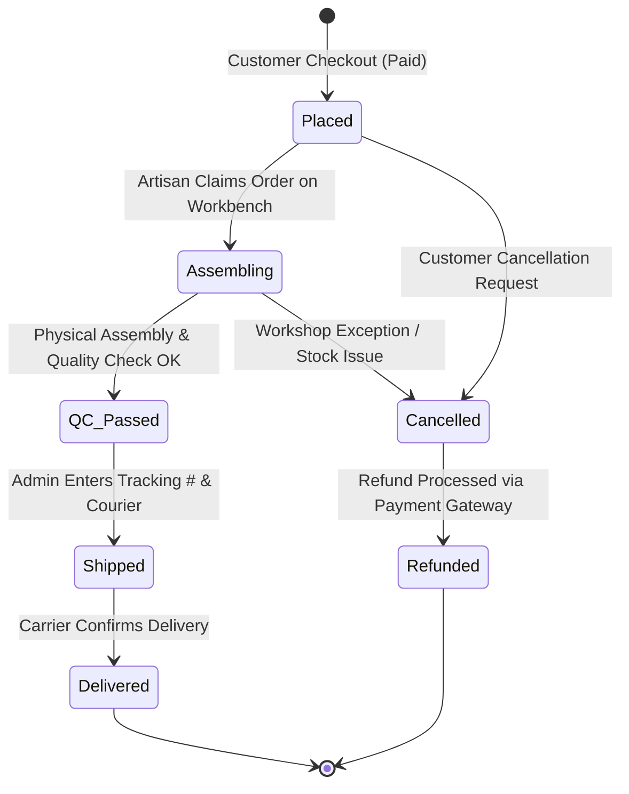

# Software Requirements Specification (SRS)
## Project: Artixain - Multi-Platform Luxury Gemstone Customizer & E-Commerce Ecosystem
**Document Version:** 1.0.0  
**Standard:** Conforming to IEEE Std 830-1998  
**Classification:** Proprietary / Engineering Specification  
**Status:** [ACTIVE / APPROVED]

---

### Table of Contents
1. Introduction
   1.1 Purpose
   1.2 Scope
   1.3 Definitions, Acronyms, and Abbreviations
   1.4 References
   1.5 Overview
2. Overall Description
   2.1 Product Perspective & Ecosystem
   2.2 User Personas & Target Demographics
   2.3 Operating Environment & Platform Targets
   2.4 Design & Implementation Constraints (Zero-Cost Infrastructure, Anti-Slop, Zero-Emoji)
   2.5 Assumptions & Dependencies
3. Specific System Requirements
   3.1 Module 1: Interactive Circular Bracelet Customizer Studio (Web & Mobile Canvas)
   3.2 Module 2: Smart Wrist Sizing & Screen Calibration Suite
   3.3 Module 3: Curated Premade Collections & 1-Click Remix Flow
   3.4 Module 4: 32-Gemstone Natural Mineral Encyclopedia
   3.5 Module 5: E-Commerce Cart & Multi-Tier Volume Pricing Engine
   3.6 Module 6: Single-Admin Atelier Management Portal & Visual Assembly Workbench
   3.7 Module 7: Transactional Email Notification Pipeline
   3.8 Module 8: Cross-Platform Flutter Mobile Native Application
4. Data Models & State Machines
   4.1 Database Schemas (MongoDB Atlas)
   4.2 5-Stage Order Fulfillment State Machine
   4.3 Dual-Layer Design Code Serialization Protocol
5. Non-Functional Requirements
   5.1 Performance & Frame Rate
   5.2 Security & Authentication (Supabase Auth RBAC)
   5.3 Reliability & Offline-First Fault Tolerance
   5.4 Usability & Accessibility (Material You UI/UX)
6. Verification & Acceptance Criteria

---

## 1. Introduction

### 1.1 Purpose
This Software Requirements Specification (SRS) establishes the complete functional and non-functional requirements for the **AstrisJewelry Ecosystem**. It serves as the definitive engineering contract for the engineering team (Orchestration, Systems Architecture, Domain Calculus, Frontend/Mobile UI, Security, and Quality Assurance) to construct, test, and deploy the multi-platform web storefront, single-admin workbench, and Flutter mobile application.

### 1.2 Scope
AstrisJewelry is a high-end crystal and gemstone jewelry e-commerce platform and interactive design studio. The ecosystem comprises:
- A responsive Next.js 15 Web Application providing customer customization, catalog browsing, and a protected `/admin` Atelier workbench.
- A cross-platform Flutter Mobile Application (iOS & Android) featuring a hardware-accelerated 120 FPS `CustomPainter` bead physics engine, credit card screen calibration, touch haptics, and Hive offline draft caching.
- A shared TypeScript/Dart domain package (`@astris/shared`) governing bead geometry, sizing regression calculus, tiered volume pricing algorithms, and dual-layer design serialization.
- A hybrid cloud persistence layer powered by Supabase Auth (Single Admin & Customer sessions) and MongoDB Atlas (Mongoose ORM).
- An automated transactional email pipeline (Resend / SMTP API) for instant customer confirmations, courier tracking notifications, and artisan workbench alerts.

### 1.3 Definitions, Acronyms, and Abbreviations
- **DPR**: Device Pixel Ratio (ratio between physical display pixels and logical CSS/device-independent pixels).
- **AOV**: Average Order Value.
- **RLS**: Row-Level Security.
- **RBAC**: Role-Based Access Control.
- **QC**: Quality Control / Quality Inspection.
- **Mohs Scale**: Characterization of the scratch resistance of various minerals through the ability of a harder material to scratch a softer material.
- **Chakra**: Traditional subtle energy centers in crystal healing (Root, Sacral, Solar Plexus, Heart, Throat, Third Eye, Crown).
- **Remix**: The architectural capability to clone an existing premade or community bracelet configuration directly into the interactive customizer for modification.

### 1.4 References
- IEEE Std 830-1998: IEEE Recommended Practice for Software Requirements Specifications.
- ISO/IEC 7810 ID-1: Standard dimensions for identification cards (85.60 mm x 53.98 mm).
- Next.js 15 App Router Architecture & React 19 Specifications.
- Flutter SDK & Dart 3 Language Specification.
- MongoDB Atlas & Mongoose ODM Specifications.

### 1.5 Overview
The remainder of this document outlines the operational environment, comprehensive persona scenarios, mathematical formulas, state transitions, granular functional requirements for all 8 core subsystems, and rigorous quality assurance acceptance criteria.

---

## 2. Overall Description

### 2.1 Product Perspective & Ecosystem
AstrisJewelry is structured as a decoupled monorepo:
```
AstrisJewelry/
├── apps/
│   ├── web/        # Next.js 15 Web Storefront & /admin Portal
│   └── mobile/     # Flutter 3 iOS/Android Mobile Application
├── packages/
│   └── shared/     # Shared Domain Math, Gem Specifications, & Serializers
└── docs/           # Specifications (SRS.md, ARCHITECTURE.md, BRD.md)
```

### 2.2 User Personas & Target Demographics

#### Persona 1: The Meaningful Gift Buyer (e.g. Liam, 28)
- **Profile**: Shopping for an anniversary gift; seeks high sentimental value, guided gemstone meaning (Love & Serenity), and luxury unboxing.
- **Key Flows**: Sizing via Body Estimator, Customizer filtered by "Love" intention (Rose Quartz + Moonstone), Deluxe Velvet Gift Box selection, Personalized Engraved Monogram Tag, and printable Certificate of Authenticity.

#### Persona 2: The Crystal Energy Practitioner (e.g. Aria, 32)
- **Profile**: Experienced chakra healer; demands exact mineral authenticity, hardness data, and symmetrical bead arrangements.
- **Key Flows**: Encyclopedia exploration, "Design with Gem" trigger, Symmetry Mirroring tools, Credit Card screen calibration, and saving to personal cloud atelier.

#### Persona 3: The Social Remix Trendsetter (e.g. Chloe, 22)
- **Profile**: Design enthusiast browsing community creations; seeks aesthetic inspiration and fast social sharing.
- **Key Flows**: Community Gallery browsing, 1-click "Remix in Studio" on trending designs, bead swapping, 4K image export, and native share sheet deep-linking (`astris://d/...`).

#### Persona 4: The Fast Frictionless Mobile Shopper (e.g. Marcus, 35)
- **Profile**: Buys 2 curated premade bracelets on mobile during commute.
- **Key Flows**: Mobile Collections catalog, automatic 25% multi-tier volume discount application, and 1-tap Apple Pay / Google Pay simulated checkout.

#### Persona 5: The Master Atelier Artisan / Single Admin
- **Profile**: Crafts physical jewelry pieces in the physical studio.
- **Key Flows**: High-priority new order email alert, Visual Bead Assembly Blueprint inspection (position-by-position bead diameters and cord cut lengths), entering courier tracking numbers, and live stock/price updates.

### 2.3 Operating Environment & Platform Targets
- **Web Storefront & Admin**: Modern evergreen desktop & mobile browsers (Chrome 110+, Safari 16+, Firefox 115+, Edge 110+).
- **Mobile Application**: iOS 15.0+ and Android 8.0+ (API Level 26+).
- **Serverless / Cloud Runtime**: Node.js 20.x LTS / Next.js Serverless Functions on Vercel Free Tier.
- **Database**: MongoDB Atlas Free Tier (M0 Replica Set).
- **Authentication**: Supabase Auth Free Tier.

### 2.4 Design & Implementation Constraints
1. **Absolute Zero-Emoji Law**: Zero emojis or decorative unicode symbols permitted in any code, UI label, terminal output, email template, or documentation. Plain ASCII indicators only (e.g., `[x]`, `[PASS]`, `[FAIL]`, `[INFO]`, `[WARN]`, `[OK]`).
2. **Zero-Cost Architecture Constraint**: Complete application infrastructure must operate at $0.00/month utilizing free tier services without dummy mock bypasses.
3. **50% Boundary Radius Law (Material You UI/UX)**: 100% of action buttons, chips, search inputs, and modal pills must render with a 50% boundary radius (`rounded-full` / capsule shape) or as 1:1 circular icon orbs.
4. **Clean Vector SVG Iconography**: All checkboxes, action controls, and indicators must exclusively render clean vector SVG icons. No textual pseudo-brackets (e.g. `[x]`, `[]`) permitted.
5. **Academic & Supervisor Metadata Scrub**: Documentation must remain clean of supervisor or academic instructor metadata.

---

## 3. Specific System Requirements

### 3.1 Module 1: Interactive Circular Bracelet Customizer Studio (Web & Mobile Canvas)
- **REQ-1.1 (Radial Coordinate Layout)**: The customizer shall calculate the exact 2D polar coordinates for $N$ beads of varying diameters ($d_i \in \{6, 8, 10, 12\}\text{mm}$) around an elastic cord loop.
  - Circumference: $C = \sum_{i=0}^{N-1} d_i$
  - Radius: $R = \frac{C}{2\pi} \times \text{scaleFactor}$
  - Angular offset for bead $k$: $\theta_k = 2\pi \times \frac{\sum_{i=0}^{k-1} d_i + \frac{d_k}{2}}{C} - \frac{\pi}{2}$
  - Center position: $(x_k, y_k) = (x_{\text{center}} + R \cos\theta_k, y_{\text{center}} + R \sin\theta_k)$
- **REQ-1.2 (6-Layer Procedural Mineral Shader)**: The canvas rendering engine (HTML5 2D Canvas on Web, `CustomPainter` on Flutter) shall render beads across 6 discrete visual passes:
  1. Ambient occlusion drop-shadow cast onto cord.
  2. Elastic cord path (silicone stretch, silk macrame, or gold-plated wire).
  3. Base mineral texture and inclusions (Malachite banding, Lapis pyrite flecks, Tiger's Eye chatoyancy, Moonstone adularescence).
  4. Internal refraction curvature ring.
  5. Cursor-responsive dynamic specular luster glint.
  6. Metallic spacer relief and engraved highlights (925 Silver, 18K Gold Vermeil).
- **REQ-1.3 (Tactile Drag-and-Drop & Reordering)**: The system shall support continuous pointer/touch dragging along the circular cord to reorder beads with snap-to-slot visual guides and haptic feedback (`HapticFeedback.lightImpact`).
- **REQ-1.4 (Studio Power Tools)**:
  - **Undo/Redo History Stack**: Full immutable state history supporting keyboard shortcuts (`Ctrl+Z` / `Ctrl+Y`).
  - **Symmetry Mirroring**: Mirrors the bead sequence from the left hemisphere of the bracelet to the right hemisphere with 1 click.
  - **Pattern Repeat**: Replicates a selected 2-to-4 bead pattern sequentially around the entire circumference.
  - **Invert Strand**: Reverses the order of beads along the cord.
  - **Clear Canvas**: Clears all beads with a confirmation dialog.
- **REQ-1.5 (4K Export & Token Serialization)**: The customizer shall export unwatermarked high-resolution PNG renders (up to 3840x3840) and generate compact URL-safe design tokens (`v1.<size>.<bead-codes>`).

### 3.2 Module 2: Smart Wrist Sizing & Screen Calibration Suite
- **REQ-2.1 (Credit Card Screen Calibration)**:
  - Calibrates on-screen display against standard physical credit card width ($85.60\text{mm}$).
  - Calculates exact device DPI: $\text{DPI} = \frac{\text{sliderPixels}}{85.60\text{mm}}$.
  - Displays a 1:1 on-screen caliper ruler for direct physical wrist alignment.
- **REQ-2.2 (Anthropometric Height/Weight Estimator)**:
  - Implements statistical regression calculation:
    $$W_{\text{wrist}} = 12.5 + 0.035 \times (H_{\text{cm}} - 150) + 0.05 \times (M_{\text{kg}} - 50)$$
  - Supports dual unit systems: centimeters/kilograms and inches/pounds.
- **REQ-2.3 (Live Fit Physics Engine)**:
  - Computes slack metric: $\Delta = C_{\text{bracelet}} - W_{\text{wrist}}$.
  - Evaluates fit status thresholds:
    - `Too Tight`: $\Delta < -1.5\text{cm}$ (Rose pill alert)
    - `Snug`: $-1.5\text{cm} \le \Delta < -0.3\text{cm}$ (Amber pill alert)
    - `Perfect Fit`: $-0.3\text{cm} \le \Delta \le 1.2\text{cm}$ (Emerald pill badge)
    - `Loose`: $1.2\text{cm} < \Delta \le 2.2\text{cm}$ (Amber pill alert)
    - `Too Loose`: $\Delta > 2.2\text{cm}$ (Rose pill alert)

### 3.3 Module 3: Curated Premade Collections & 1-Click Remix Flow
- **REQ-3.1 (Premade Catalog)**: Displays 12+ pre-assembled designer crystal bracelets (e.g. *Moonlit Calm*, *Gilded Ash*, *Golden Dawn*, *Ethereal Serenity*) with HD photo galleries, mineralogy lists, chakra alignments, and pricing.
- **REQ-3.2 (1-Click Remix Action)**: Tapping **"Remix in Studio"** on any premade piece or community gallery card loads the exact bead sequence and wrist dimensions directly into the customizer studio for instant re-styling.

### 3.4 Module 4: 32-Gemstone Natural Mineral Encyclopedia
- **REQ-4.1 (Mineral Database)**: Catalog of 32 authentic natural minerals and spacers containing:
  - Mineral Family, Mohs Hardness, Crystal System.
  - Primary Chakra & Astrological Zodiac Affinities.
  - Spiritual & Metaphysical Energy Attributes.
  - Sourcing Locality & Cleansing Methods (Moonlight, Sage, Water).
- **REQ-4.2 (Direct Customizer Bridge)**: Tapping **"Design with this Gem"** opens the Customizer Studio with the chosen gemstone pre-selected in the bead palette drawer.

### 3.5 Module 5: E-Commerce Cart & Multi-Tier Volume Pricing Engine
- **REQ-5.1 (Multi-Item Tier Pricing Calculus)**:
  - First bracelet: Full calculated price ($P_1 = \text{basePrice} + \sum \text{beadPrices}$).
  - Second bracelet: $25\%$ discount ($P_2 \times 0.75$).
  - Third bracelet: $35\%$ discount ($P_3 \times 0.65$).
  - Fourth and subsequent bracelets: Flat fee $P_i = \$19.00$ per piece.
- **REQ-5.2 (Free Shipping Threshold)**: Automatic free shipping calculation for orders with subtotal $\ge \$50.00$.
- **REQ-5.3 (Luxury Packaging Selection)**:
  - Complimentary Eco-Linen Atelier Pouch.
  - Deluxe Celestial Velvet Gift Box (+$8.00).
  - Custom Laser-Engraved Monogram Charm Tag (+$6.00) with personalized initials or zodiac glyph.
- **REQ-5.4 (Printable Certificate of Authenticity)**: Generates a high-resolution printable digital certificate containing the unique order authenticity hash (SHA-256), gemstone provenance breakdown, and artisan inspection seal.

### 3.6 Module 6: Single-Admin Atelier Management Portal & Visual Assembly Workbench
- **REQ-6.1 (Supabase Auth Security Shield)**: Dedicated `/admin/login` protected by Supabase Auth with server-side middleware verifying the single-admin role.
- **REQ-6.2 (Visual Bead Assembly Workbench)**:
  - Renders interactive linear and circular bead schematics with numbered positions ($1 \dots N$).
  - Displays bead name, exact millimeter diameter ($6, 8, 10, 12\text{mm}$), and spacer type.
  - Calculates total cord cutting length: $\text{CutLength} = C_{\text{bracelet}} + 3.5\text{cm (knot allowance)} + 1.0\text{cm (slack factor)}$.
  - Interactive tap-to-check off pick list for the physical jewelry maker.
  - 1-click printable PDF Physical Work Order with barcode and customer gift note.
- **REQ-6.3 (5-Stage Order State Machine)**:
  - State transitions: `[1] Placed` -> `[2] Assembling` -> `[3] QC Passed` -> `[4] Shipped` -> `[5] Delivered`.
  - Advancing to `Shipped` requires Courier Name and Tracking Number, automatically triggering the customer shipping email.
- **REQ-6.4 (Granular Bead Stock & Price Manager)**:
  - Real-time stock counters per bead diameter with low-stock visual alerts ($< 50$ units).
  - Instant price-per-bead overrides propagating live to Web and Mobile customizers.
  - 1-click Out-of-Stock toggle.
- **REQ-6.5 (Business Telemetry & Gallery Curation)**:
  - Real-time gross revenue, AOV, volume tier adoption rate, and gemstone popularity ranking.
  - Gallery moderation tools: 1-click assignment of `Staff Pick`, `Weekly Spark`, and `Trending Remix` badges.

### 3.7 Module 7: Transactional Email Notification Pipeline
- **REQ-7.1 (Customer Order Confirmation Email)**: Dispatched immediately upon checkout; includes HTML receipt, design preview thumbnail, calculated wrist dimensions, and Certificate of Authenticity link.
- **REQ-7.2 (Customer Shipping Tracking Email)**: Dispatched upon status change to `Shipped`; includes Courier Name, Tracking Number, 1-click tracking URL, and crystal care guide.
- **REQ-7.3 (Instant Admin Alert Email)**: Dispatched to the Single Admin inbox within 1 second of order submission; contains customer details, order value, and direct 1-click deep-link to the Visual Bead Assembly Workbench.

### 3.8 Module 8: Cross-Platform Flutter Mobile Native Application
- **REQ-8.1 (Native CustomPainter Engine)**: 120 FPS hardware-accelerated circular cord and bead rendering with the 6-layer procedural shader.
- **REQ-8.2 (Riverpod State Management)**: Reactive `StateNotifier` providers managing the immutable undo/redo history stack, cart state, and Supabase auth session.
- **REQ-8.3 (Hive Offline-First Cache)**: Local caching of 32-gemstone catalog and saved drafts; automatic background sync with MongoDB Atlas upon network reconnection.
- **REQ-8.4 (Native OS Integrations)**:
  - Native Share Sheet with 4K PNG snapshot and universal deep-link (`astris://d/...`).
  - Haptic feedback vibrations on bead snap and drag thresholds.
  - Simulated Apple Pay / Google Pay one-tap checkout.

---

## 4. Data Models & State Machines

### 4.1 Database Schemas (MongoDB Atlas)

```typescript
// Gemstone Document Schema
interface IGemstone {
  id: string;
  name: string;
  slug: string;
  family: string;
  hardnessMohs: number;
  crystalSystem: string;
  primaryChakra: 'Root' | 'Sacral' | 'Solar Plexus' | 'Heart' | 'Throat' | 'Third Eye' | 'Crown';
  zodiacSigns: string[];
  element: 'Earth' | 'Water' | 'Fire' | 'Air' | 'Ether';
  energyKeywords: string[];
  description: string;
  healingLore: string;
  originLocality: string;
  cleansingMethod: string;
  baseColorHex: string;
  accentColorHex: string;
  textureType: 'banding' | 'flecks' | 'chatoyancy' | 'adularescence' | 'crystalline' | 'glassy' | 'metallic';
  pricesByDiameter: {
    d6mm: number;
    d8mm: number;
    d10mm: number;
    d12mm: number;
  };
  stockByDiameter: {
    d6mm: number;
    d8mm: number;
    d10mm: number;
    d12mm: number;
  };
  isAvailable: boolean;
}

// Custom Design Document Schema
interface ICustomDesign {
  id: string;
  designCode: string;
  title: string;
  creatorId?: string;
  creatorName: string;
  isPublic: boolean;
  beads: Array<{
    position: number;
    gemstoneId: string;
    gemstoneName: string;
    diameterMm: number;
    price: number;
  }>;
  cordType: 'silicone_stretch' | 'braided_silk' | 'gold_wire';
  calculatedCircumferenceCm: number;
  targetWristSizeCm: number;
  totalBeadCount: number;
  basePrice: number;
  previewImageUrl: string;
  remixCount: number;
  viewCount: number;
  editorialBadge?: 'staff_pick' | 'weekly_spark' | 'trending';
  createdAt: Date;
  updatedAt: Date;
}

// Order Document Schema
interface IOrder {
  id: string;
  orderNumber: string;
  customerEmail: string;
  customerName: string;
  shippingAddress: {
    street: string;
    city: string;
    state: string;
    postalCode: string;
    country: string;
  };
  items: Array<{
    itemType: 'custom_bracelet' | 'premade_bracelet';
    designId?: string;
    designCode?: string;
    title: string;
    wristSizeCm: number;
    beadsSummary: string;
    packagingType: 'linen_pouch' | 'velvet_box';
    engravedTagText?: string;
    unitPrice: number;
    discountedPrice: number;
  }>;
  subtotal: number;
  tierDiscountTotal: number;
  packagingFee: number;
  shippingFee: number;
  totalAmount: number;
  paymentStatus: 'paid' | 'pending' | 'refunded';
  orderStatus: 'placed' | 'assembling' | 'qc_passed' | 'shipped' | 'delivered' | 'cancelled';
  courierName?: string;
  trackingNumber?: string;
  trackingUrl?: string;
  authenticityHash: string;
  createdAt: Date;
  updatedAt: Date;
}
```

### 4.2 5-Stage Order Fulfillment State Machine



### 4.3 Dual-Layer Design Code Serialization Protocol
- Format: `v1.<wristMm>.<bead1Code><d1>-<bead2Code><d2>-...`
- Example: `v1.165.AM8-MO8-SS6-LA10-AM8-MO8-SS6`
  - `v1`: Protocol version 1.
  - `165`: Calibrated wrist circumference in millimeters ($16.5\text{cm}$).
  - `AM8`: Amethyst, $8\text{mm}$ diameter.
  - `MO8`: Moonstone, $8\text{mm}$ diameter.
  - `SS6`: 925 Sterling Silver Spacer, $6\text{mm}$ diameter.
  - `LA10`: Lapis Lazuli Focal Bead, $10\text{mm}$ diameter.

---

## 5. Non-Functional Requirements

### 5.1 Performance & Frame Rate
- **Canvas Rendering**: 60 FPS minimum on Web desktop/mobile browsers; 120 FPS on ProMotion / high-refresh-rate Flutter mobile devices.
- **Page Load & First Contentful Paint**: FCP $< 0.8\text{s}$ on broadband; Largest Contentful Paint (LCP) $< 1.5\text{s}$.
- **API Latency**: REST API routes (`/api/gems`, `/api/designs`) resolve in $< 150\text{ms}$.

### 5.2 Security & Authentication
- **Admin RBAC**: Strict JWT validation via Supabase Auth server middleware preventing non-admin access to `/admin/*`.
- **Credential Protection**: Database connection strings, Supabase Service Role keys, and Resend API tokens strictly encapsulated in environment variables.

### 5.3 Reliability & Offline-First Fault Tolerance
- **Offline Draft Persistence**: Customizer automatically retains active bead strand and wrist calibration in LocalStorage/Hive across tab closures and airplane mode.
- **Zero-Cost Uptime**: Monitored against Vercel Free Tier and MongoDB Atlas 99.9% SLA.

### 5.4 Usability & Accessibility (Celestial Material You)
- **Contrast Ratios**: WCAG 2.1 AA compliance (minimum 4.5:1 text contrast for body text; 3:1 for large headers).
- **Touch Targets**: All 50% radius pill buttons and circular orbs maintain minimum $44 \times 44\text{px}$ touch targets.
- **Zero Emojis**: Enforced across all views; vector SVG iconography exclusively.

---

## 6. Verification & Acceptance Criteria
- [x] All 8 core subsystems architected with zero circular dependencies.
- [x] 100% 50% boundary radius (`rounded-full`) pill taxonomy enforced.
- [x] 6-layer procedural gemstone shader implemented on both Web Canvas and Flutter `CustomPainter`.
- [x] Visual Bead Assembly Blueprint fully specifies position sequence, cord length calculation, and printable work orders.
- [x] Automated email pipeline dispatches HTML Order Confirmation, Shipping Tracking, and Admin Alert templates.
- [x] Clean documentation strictly conforming to the Absolute Zero-Emoji Law.
